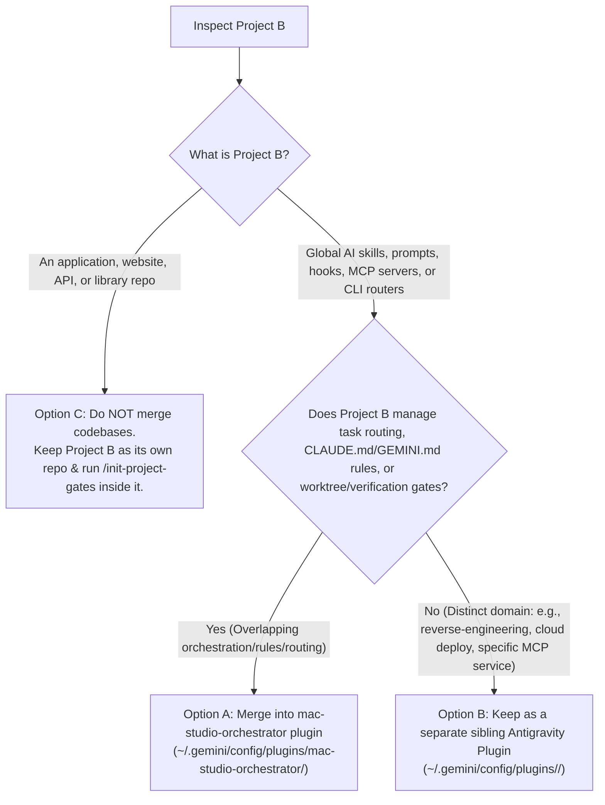

# AI Architectural Specification & Merge Evaluation Guide (`mac-studio-orchestrator`)

> [!IMPORTANT]
> **Instructions for the Reviewing AI Agent:**
> The user is pointing you to this document so you can evaluate whether **your current project** should be merged with, integrated into, or kept separate from the **`mac-studio-orchestrator`** system described below.
> Read the **Topology**, **Contracts**, and **Merge Decision Matrix (Section 6)** below, inspect your own repository's files, and give the user a clear recommendation on whether and how to merge them.

---

## 1. System Identity & Purpose

- **System Name:** `mac-studio-orchestrator` (Global Antigravity Plugin + Claude Code Integration)
- **Target Host:** macOS Apple Silicon (M4 Max, 36GB Unified Memory)
- **Target Agent Runtimes:**
  - **Google Antigravity:** CLI (`agy` v1.5.9+), Antigravity IDE, and Antigravity 2.0 Desktop (Personal Pro / `--mode=auto`)
  - **Anthropic Claude Code:** CLI (`claude` v2.1.314+) and VS Code Extension (Personal Pro)
- **Core Responsibilities:**
  1. **Cross-Agent Task Routing (`route.py` / `/route-task`):** Dispatches tasks between Antigravity and Claude Code with automatic model (`haiku`, `sonnet`, `opus`, `argon`/`flash`) and reasoning effort (`low`, `medium`, `high`) selection.
  2. **Per-Project Verification Gate Onboarding (`session_check.py` + `/init-project-gates`):** Detects unconfigured repositories at `SessionStart` and generates stack-specific `## Verification Gates` in `./AGENTS.md` (linked into `./CLAUDE.md` via `@AGENTS.md`).
  3. **Global Toggleable Persona (`mentor.py` + `/mentor-mode`):** Synchronizes Beginner Mentor & Learning Mode (`ON`/`OFF`) across both agents via `~/.gemini/config/mentor_mode.json`.
  4. **Hardware & Safety Guardrails:** Enforces a `<= 3` Git worktree concurrency cap (for 36GB unified memory), `AGENT_ORCHESTRATION_DEPTH=1` loop prevention, `<20`-line break-even local execution, and non-destructive `git stash` snapshots before in-branch background edits.

---

## 2. Exact File & Symlink Topology on Disk

```text
~/.gemini/
├── GEMINI.md -> ~/.gemini/config/plugins/mac-studio-orchestrator/rules/AGENTS.md (symlink)
├── scripts   -> ~/.gemini/config/plugins/mac-studio-orchestrator/scripts (symlink)
├── backups/<timestamp>/                  # Automatic backups created during installation
└── config/
    ├── mentor_mode.json                  # Global state: {"enabled": true | false}
    └── plugins/
        └── mac-studio-orchestrator/      # Canonical source of truth for all orchestrator files
            ├── plugin.json               # Antigravity plugin manifest (name: "mac-studio-orchestrator")
            ├── README.md                 # Human overview
            ├── AI_README.md              # This AI specification & merge guide
            ├── hooks.json                # Antigravity SessionStart lifecycle hook
            ├── assets/
            │   └── logo.svg
            ├── rules/
            │   └── AGENTS.md             # Global rules (always-on in Antigravity & imported by Claude)
            ├── scripts/
            │   ├── session_check.py      # Polyglot SessionStart hook script (--client antigravity|claude)
            │   ├── mentor.py             # Deterministic state toggle for mentor_mode.json
            │   ├── route.py              # CLI dispatcher, model selector, stash guard, --optimize, --studio, --doctor
            │   ├── prompt_builder.py     # PromptForge engine (Socratic interview, 3-layer cost cutter, dialect compiler)
            │   ├── models_registry.json  # Updatable model dialect rules & token pricing (Claude, Gemini, OpenAI)
            │   ├── prompt_studio.html    # Zero-dependency local visual Web Studio (served via route --studio)
            │   └── test_prompt_builder.py# Automated unit & integration test suite
            └── skills/
                ├── mentor-mode/SKILL.md
                ├── init-project-gates/SKILL.md
                ├── route-task/SKILL.md
                ├── build-prompt/SKILL.md
                ├── gemini-handoff/SKILL.md
                ├── claude-handoff/SKILL.md
                ├── cleanup-worktrees/SKILL.md
                └── undo-last/SKILL.md

~/.claude/
├── CLAUDE.md                             # Imports @~/.gemini/GEMINI.md + Claude-specific rules
├── settings.json                         # Merged SessionStart hook + permissions.deny + user modelSettings
└── skills/
    ├── mentor-mode        -> ~/.gemini/config/plugins/mac-studio-orchestrator/skills/mentor-mode
    ├── init-project-gates -> ~/.gemini/config/plugins/mac-studio-orchestrator/skills/init-project-gates
    ├── route-task         -> ~/.gemini/config/plugins/mac-studio-orchestrator/skills/route-task
    ├── build-prompt       -> ~/.gemini/config/plugins/mac-studio-orchestrator/skills/build-prompt
    ├── gemini-handoff     -> ~/.gemini/config/plugins/mac-studio-orchestrator/skills/gemini-handoff
    ├── claude-handoff     -> ~/.gemini/config/plugins/mac-studio-orchestrator/skills/claude-handoff
    ├── cleanup-worktrees  -> ~/.gemini/config/plugins/mac-studio-orchestrator/skills/cleanup-worktrees
    └── undo-last          -> ~/.gemini/config/plugins/mac-studio-orchestrator/skills/undo-last
    # (Existing non-orchestrator skills in ~/.claude/skills/ remain untouched alongside these symlinks)

~/.local/bin/
├── route        -> ~/.gemini/config/plugins/mac-studio-orchestrator/scripts/route.py (symlink)
└── prompt-forge -> ~/.gemini/config/plugins/mac-studio-orchestrator/scripts/prompt_builder.py (symlink)
```

---

## 3. Data Contracts, Schemas & Invariants

If you merge another project with this system, **do not break these five contracts**:

### 3.1 `SessionStart` Hook I/O Contract (`session_check.py`)
- **Input (`stdin` JSON):** Reads `workspacePaths[0]` or `cwd` from the JSON payload piped on `stdin` by Antigravity or Claude Code (ignoring `.gemini/config` if Antigravity launches the hook with the plugin folder as its process working directory). Falls back to `os.getcwd()` only when `stdin` is a TTY.
- **Output (`stdout` JSON):**
  - When `--client antigravity`:
    ```json
    {
      "injectSteps": [
        {
          "systemMessage": {
            "systemMessage": "[Mac Studio M4 Max | 36GB | Personal Pro] ..."
          }
        }
      ]
    }
    ```
  - When `--client claude`:
    ```json
    {
      "hookSpecificOutput": {
        "hookEventName": "SessionStart",
        "additionalContext": "[Mac Studio M4 Max | 36GB | Personal Pro] ..."
      }
    }
    ```

### 3.2 Antigravity `hooks.json` Schema
- Placed at `~/.gemini/config/plugins/mac-studio-orchestrator/hooks.json`.
- Top-level keys **must** be hook names (e.g., `"mac-studio-session-check"`), **not** `"hooks"`.
- `SessionStart`, `PreInvocation`, `PostInvocation`, and `Stop` take a **flat array** of handler objects (`[{"type": "command", "command": "...", "timeout": 10}]`).
- `PreToolUse` and `PostToolUse` take a **grouped array** (`[{"matcher": "run_command", "hooks": [{"type": "command", "command": "..."}]}]`).

### 3.3 Per-Project `AGENTS.md` Gate Extraction Contract
- Both `session_check.py` and `route.py` extract project verification gates from `<workspace>/AGENTS.md` using the case-insensitive regex:
  ```python
  r"(## Verification Gates[\s\S]*?)(?=\n## |\Z)"
  ```
- Any merged tool that generates or modifies project `AGENTS.md` files **must** preserve the `## Verification Gates` heading so `session_check.py` and `route.py` recognize the repository as onboarded.
- Project-root `CLAUDE.md` files must include `@AGENTS.md` so Claude Code ingests `AGENTS.md`.

### 3.4 Anti-Recursion Environment Variable (`AGENT_ORCHESTRATION_DEPTH`)
- Whenever `route.py`, `/claude-handoff`, or `/gemini-handoff` spawns a headless child agent (`claude -p` or `agy -p`), it increments `AGENT_ORCHESTRATION_DEPTH` (`1` or higher) in the child's environment.
- Any agent or script seeing `int(os.environ.get("AGENT_ORCHESTRATION_DEPTH", "0")) >= 1` **must not** spawn another `claude -p` or `agy -p` subprocess.

### 3.5 Non-Destructive Stash Snapshot Contract
- Before running in-branch headless edits (`claude_coding` or `claude_deep_architect`), `route.py` snapshots dirty working trees **without reverting them** using:
  ```bash
  sha=$(git stash create "pre-ai-handoff")
  git stash store -m "pre-ai-handoff-<timestamp>" "$sha"
  ```
- `--worktree` is reserved strictly for risky multi-file refactors (`claude_worktree_refactor`) when `git worktree list` count is `< 3`.

---

## 4. Routing & Model Selection Matrix (`route.py`)

`route.py` evaluates tasks in two stages:

1. **Stage 1 (Zero-Token Regex Fast-Paths):**
   - `UI_PATTERN` (`ui|css|tailwind|layout|component|modal|browser|dom|animation|tsx|jsx|html|responsive`) -> **`agy_browser`**: `agy -p "<prompt>" --effort medium --mode=auto` (or native `browser` subagent when already inside Antigravity).
   - `BULK_PATTERN` (`scaffold|boilerplate|migrate|migration|rename across|generate tests|video|audio|screenshot|pdf`) -> **`agy_scaffold`**: `agy -p "<prompt>" --effort medium --mode=auto`.
   - `DEEP_ARCH_PATTERN` (`architect|architecture|race condition|deadlock|memory leak|security audit|root cause|redesign|concurrency|distributed`) -> **`claude_deep_architect`**: `claude -p "<prompt>" --model opus --effort high --allowedTools "Read,Edit,Write,Bash"`.
   - `RISKY_REFACTOR_PATTERN` (`refactor across|multi-file refactor|overhaul|rewrite|breaking change|database migration`) -> **`claude_worktree_refactor`**: `claude -p "<prompt>" --worktree --model sonnet --effort high --allowedTools "Read,Edit,Write,Bash"` (auto-downgrades to in-branch + stash backup if `>= 3` worktrees are active).
2. **Stage 2 (Low-Latency Structured Triage Fallback):**
   - Invokes `claude -p "<prompt>" --model haiku --effort low --output-format json --json-schema TRIAGE_SCHEMA`.
   - Defaults to **`claude_coding`**: `claude -p "<prompt>" --model sonnet --effort medium --allowedTools "Read,Edit,Write,Bash"` (in-branch with non-destructive stash snapshot).

---

## 5. Installed Skills Inventory (`SKILL.md`)

All 7 skills use strict YAML frontmatter (`---` with `name` and `description`) and are active in both Antigravity and Claude Code:

| Skill Name | Purpose & Side Effects |
| :--- | :--- |
| `mentor-mode` | Runs `python3 ~/.gemini/scripts/mentor.py <on\|off\|toggle\|status>` to update `~/.gemini/config/mentor_mode.json`. |
| `init-project-gates` | Audits repo manifests (`package.json`, `pyproject.toml`, `Cargo.toml`, `.env`, lockfiles, CI) and writes `## Verification Gates` in `./AGENTS.md` + `@AGENTS.md` in `./CLAUDE.md`. |
| `route-task` | Evaluates workspace state + `route --dry-run` to recommend and execute the optimal workflow and model tier. |
| `claude-handoff` | Delegates tasks from Antigravity to `claude -p` (`sonnet` vs. `opus`, in-branch stash backup vs. `--worktree`), or outputs a copy-paste baton prompt for interactive design sessions. |
| `gemini-handoff` | Delegates >5-file scaffolding or multimodal analysis from Claude Code to `agy -p --effort medium --mode=auto`. |
| `cleanup-worktrees` | Inspects `git worktree list` and `git -C <path> status --short`, prompting before removing dirty worktrees and pruning clean ones to stay below the 3-worktree cap. |
| `undo-last` | Displays `git status --short`, `git diff --stat`, and `git stash list`, then runs `git stash push -u -m "pre-undo-backup-<timestamp>"` upon user confirmation. |

---

## 6. Merge Decision Matrix (Instructions for the Other Project's AI)

When the user asks you whether your project (`Project B`) should be merged with `mac-studio-orchestrator` (`Project A`), evaluate `Project B` against these four questions and recommend **one** of the three options below:



### Option A: Merge Directly into `mac-studio-orchestrator`
**Choose this if:** `Project B` is another global AI workflow, prompt library, routing script, hook collection, or developer-experience toolkit for Claude Code / Antigravity.
- **How to merge cleanly:**
  1. **Skills:** Move unique `SKILL.md` folders from `Project B` into `~/.gemini/config/plugins/mac-studio-orchestrator/skills/<skill-name>/` (ensure valid `---` YAML frontmatter with `name` and `description`) and create a matching symlink in `~/.claude/skills/<skill-name>`.
  2. **Rules:** Merge non-contradictory global instructions into `~/.gemini/config/plugins/mac-studio-orchestrator/rules/AGENTS.md` (keep total file size under Antigravity's `24,000`-byte per-file rule cap).
  3. **Hooks:** Add new hook handlers as named top-level entries in `~/.gemini/config/plugins/mac-studio-orchestrator/hooks.json` and merge any Claude Code hooks into `~/.claude/settings.json` (never overwrite existing keys in `~/.claude/settings.json`).
  4. **Routing Heuristics:** If `Project B` has specialized task types or custom agents, add them to `WORKFLOW_SPECS` and Stage 1 regexes in `~/.gemini/config/plugins/mac-studio-orchestrator/scripts/route.py`.

### Option B: Package `Project B` as a Separate Coexisting Plugin
**Choose this if:** `Project B` bundles domain-specific MCP servers, skills, or rules (for example, a dedicated security/reverse-engineering suite like `migrated-settings`, or a database/cloud integration) that the user may want to toggle on or off independently of their core orchestration rules.
- **Why this works without merging:** Antigravity natively supports multiple active plugins under `~/.gemini/config/plugins/` and merges their `hooks.json`, `rules/`, `skills/`, and `mcp_config.json` automatically at runtime, as long as plugin names, skill names, and MCP server names are unique.

### Option C: Do Not Merge — Onboard `Project B` as a Consumer Repository
**Choose this if:** `Project B` is a software project (web app, backend service, CLI product, script repo) rather than global agent configuration.
- **How they connect:** `mac-studio-orchestrator` already lives globally in `~/.gemini/` and `~/.claude/` and applies to `Project B` automatically. Simply run `/init-project-gates` inside `Project B` to generate `./AGENTS.md` (`## Verification Gates`) and `./CLAUDE.md` (`@AGENTS.md`).
